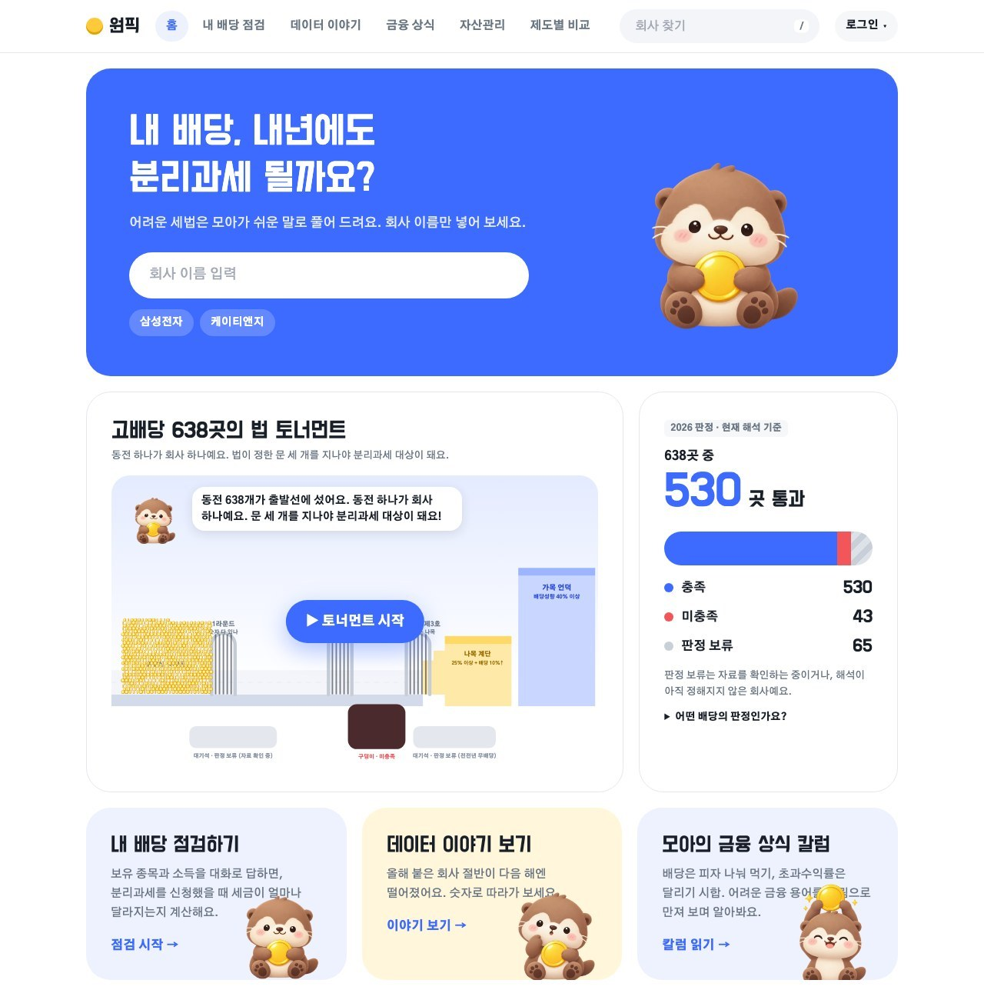
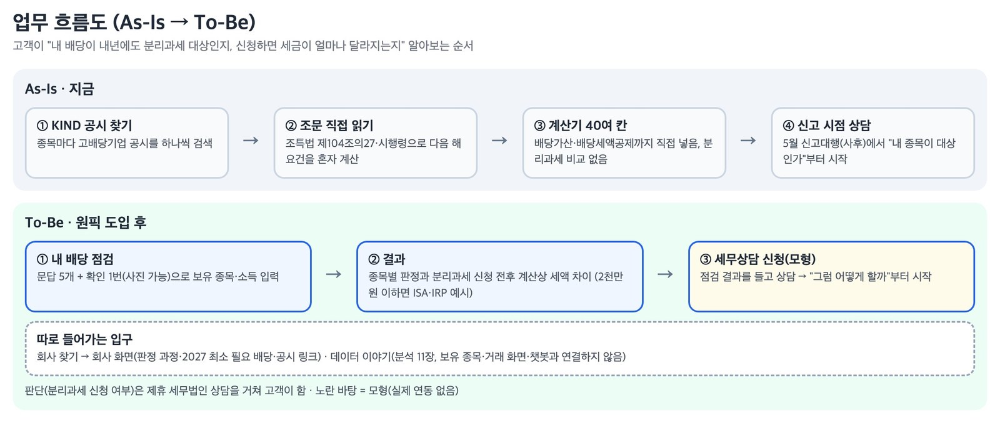
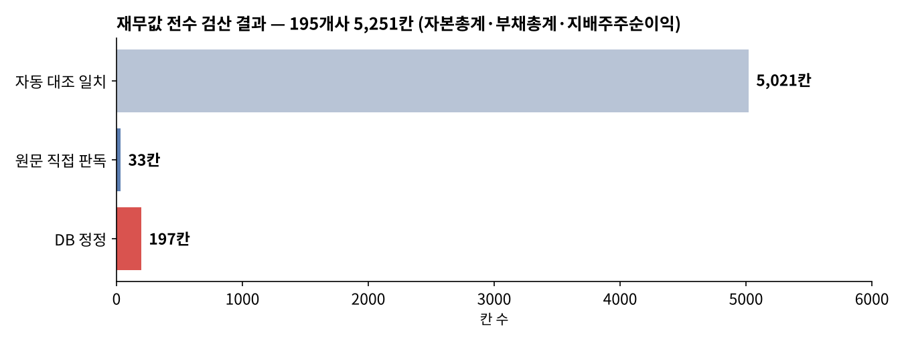
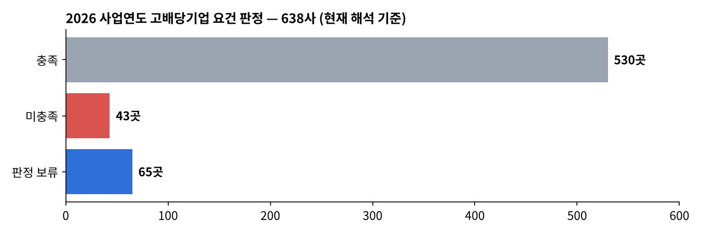
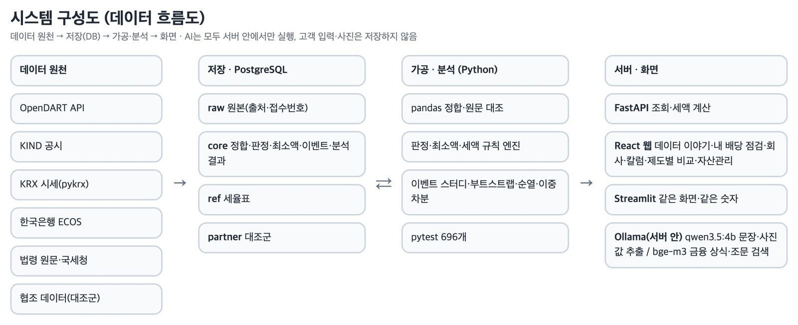
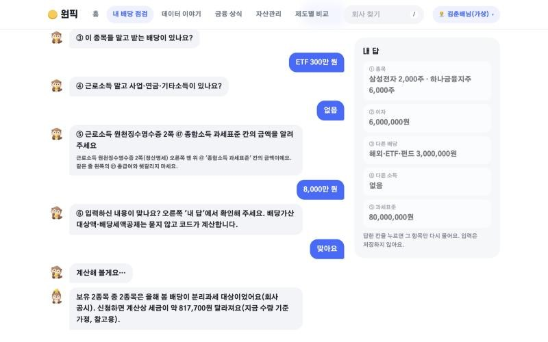
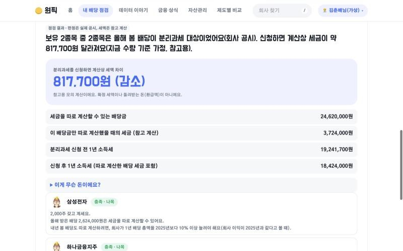
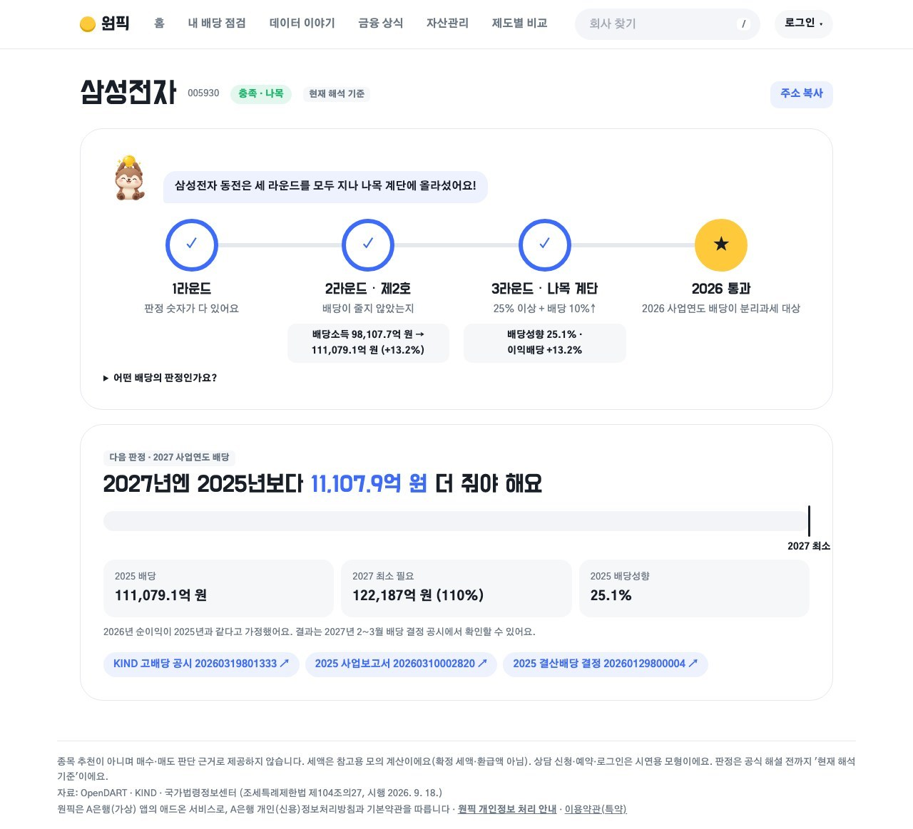

# 원픽(ONE PICK) — 내 고배당주, 내년에도 분리과세 받을 수 있을까

> 고배당기업 638사의 공시·재무·주가를 모아, 고객이 가진 종목이 **다음 해에도 배당소득 분리과세 대상으로 남을지**와 **신청하면 세금이 얼마나 달라지는지**를 근거와 함께 미리 점검하는 웹 서비스입니다.
> KB-Bridge 종합프로젝트 **우수상 (4팀 중 2위)**

| 항목 | 내용 |
|---|---|
| 형태 | KB-Bridge AI 활용 기반 금융 데이터 과정 종합프로젝트 · 5인 팀 (1조) · 2026.10.19 – 11.05 |
| 사용 기술 | Python (pandas, NumPy) · PostgreSQL / DuckDB · SQL · FastAPI · React · Streamlit · OpenDART · KRX · ECOS · Ollama · pytest 703개 |
| 데이터 | KIND 고배당기업 638사 · DART 배당·재무 · 배당 결정 공시 2,749건 · KRX 일별 시세 124만 행 · 한국은행 거시지표 · 법령 원문 |
| 핵심 결과 | 638사 판정 (충족 530 · 미충족 43 · 판정 보류 65) · 공시 원문 대조 120,996칸 중 99.5% 일치 · **우수상** |

**내 역할 : 데이터 검증·사용자 관점 테스트 담당 (5인 팀, AI 도구 활용)**

- 195개사 재무값 5,251칸을 DART 원문과 전수 대조해 정정이 필요한 값 197칸을 찾아 DB에 반영
- 638사 일별 시세 124만 행을 검증 노트북으로 점검해 종목코드 오류·수정주가 누락을 찾고, 네이버 종가 18,872개·시장지수 2,157일 대조 불일치 0을 확인
- 챗봇 사진 입력 17개 시나리오를 점검해 숫자 오저장 치명 버그 2건 등 문제 8건을 찾아 시연 전 수정



---

## 01. 프로젝트 배경

2026년 1월 1일 이후 받는 **고배당기업 배당은 신청하면 14~30% 세율로 분리과세**할 수 있습니다(조세특례제한법 제104조의27, 2028년까지 한시). 그런데 고배당기업 여부는 **해마다 직전 사업연도 숫자로 다시 판정**됩니다.

- 지금 법을 2018\~2023년 숫자에 대어 보면, 요건을 채운 회사의 **46.6\~56.1%가 다음 해에 탈락**했습니다.
- KIND 공시는 이미 정해진 배당이 대상인지만 알려 줍니다. 다음 배당도 대상이 되려면 회사가 얼마를 배당해야 하는지는 고객이 직접 계산하기 어렵습니다.
- 시중은행 챗봇과 세금계산기는 "내 종목이 내년에도 대상인가"를 알려 주지 않습니다.



## 02. 업무 문제

| 고객의 질문 | 원픽의 답 |
|---|---|
| 내 종목 배당이 내년에도 분리과세 대상일까? | 638사 요건 판정 + 판정 과정과 공시 접수번호 근거 |
| 회사는 얼마를 배당해야 요건을 지키나? | 회사별 **2027 최소 필요 배당액** |
| 신청하면 올해 내 세금은 얼마나 달라지나? | 문답 5개 + 확인 1번으로 신청 전후 **세액 차이 계산** |

**운영 원칙** — 종목 추천·주가 예측·유지 확률을 만들지 않고, 세액은 "참고용 모의 계산"으로만 보여 줍니다(자본시장법·세무사법·인공지능기본법 고려).

## 03. 데이터 설명

| 데이터 | 출처 | 규모 |
|---|---|---|
| 고배당기업 목록 | KIND | 638사 (계획 639사 중 상장폐지 1곳 제외) |
| 배당·재무제표 | OpenDART API, 사업보고서 원문 | 2017–2026 |
| 배당 결정 공시 | DART | 2,749건 |
| 일별 수정주가·시장지수 | KRX (pykrx) | 124만 행 (2018.01 – 2026.10) |
| 거시지표 | 한국은행 ECOS | 금리·환율 등 |
| 법령 원문 | 국가법령정보센터 | 조특법·시행령·소득세법 조문 |
| 밸류업 공시 | KIND | 888건 (문서 1,230건 OCR) |

- 저장 구조: PostgreSQL `raw`(받은 원본) → `core`(검증·판정·분석 결과) → `ref`(세율표), 표·보기 74개
- 제출용 DB는 DuckDB 파일 하나(256MB)로 옮겼습니다. **GitHub 파일 한도(100MB)를 넘어 저장소에서는 뺐고**, 검증에 쓴 일부만 [`data/sample/`](data/sample/)에 CSV로 넣었습니다. 여는 법: [`docs/DB_읽는_법.txt`](docs/DB_읽는_법.txt)

## 04. 데이터 전처리 · 검증

팀 전체로는 **공시 원문 대조 120,996칸 중 99.5%가 일치**했고, 다르거나 못 찾은 칸과 DART 재대조분을 합친 1,578칸을 모두 처리했습니다. 배당 숫자는 출처 세 곳(KIND · DART · 현금흐름표)을 섞지 않고 따로 보관했습니다.

**내 담당 ① 재무값 전수 검산** — 195개사 × 2017~2026 × 3항목(자본총계·부채총계·지배주주순이익)



| 구분 | 칸 수 | 처리 |
|---|---:|---|
| 자동 대조 일치 | 5,021 | DART 재무 API·사업보고서 원문 표와 3항목 일치 → 확인 완료 |
| 원문 직접 판독 | 33 | 코드로 못 읽은 표를 원문에서 직접 확인 |
| **DB 정정** | **197** | 빈칸이었지만 원문에 값이 있거나 값이 다른 칸 → 원문 값·접수번호를 적어 DB에 반영 |

- 검산표 규칙상 값 칸은 직접 고치지 않고 메모로 넘겼습니다. 엑셀만 고치면 DB와 값이 어긋나기 때문입니다.

**내 담당 ② KRX 시세 검증** — Colab 검증 노트북으로 638사 시세 파일을 점검

| 검사 | 결과 |
|---|---|
| 회사 누락·중복, 빈칸, 거래일 수 | 정상 |
| 하루 등락 ±31% 초과 | 0건 (수정주가 보정 6건) |
| 네이버 종가 대조 | 18,872개 불일치 0 |
| KOSPI·KOSDAQ 지수 대조 | 2,157일 차이 0 |
| 종목코드 변환 오류 | `0008Z0`(에스엔시스)이 `000080`(하이트진로)으로 바뀌는 문제 발견 |

## 05. SQL 분석

검증 결과를 SQL로 다시 집계했습니다. → [`sql/role_check.sql`](sql/role_check.sql)

```sql
-- 재무값 전수 검산: 검토 구분별 칸 수
SELECT CASE
         WHEN memo LIKE '[자동 대조]%'      THEN '1. 자동 대조 일치'
         WHEN memo LIKE '[원문 직접 판독]%' THEN '2. 원문 직접 판독'
         ELSE '3. DB 정정'
       END AS 구분,
       COUNT(*) AS 칸수, COUNT(DISTINCT corp_code) AS 회사수
FROM review_values
GROUP BY 1 ORDER BY 1;
```

| 구분 | 칸 수 | 회사 수 |
|---|---:|---:|
| 1. 자동 대조 일치 | 5,021 | 195 |
| 2. 원문 직접 판독 | 33 | 8 |
| 3. DB 정정 | **197** | 34 |

DB 정정 197칸은 항목별로 자본총계 67 · 부채총계 67 · 지배주주순이익 63칸이었습니다.

```bash
python sql/run_sql.py   # data/sample CSV → SQLite, DB 파일·API 키 불필요
```

## 06. Python 분석 · 서비스 구현

| 구성 | 내용 |
|---|---|
| 판정 엔진 | 법이 산식을 정하므로 **규칙으로 계산** (배당성향 25%·40%, 전년 대비 배당 10% 증가 등). 경계값 바로 아래·경계·위를 pytest로 확인 |
| 2027 최소 필요 배당 | 내년에도 요건을 지키려면 회사가 최소 얼마를 배당해야 하는지 회사별 계산 |
| 세액 비교 | 분리과세 신청 전후 세액 차이, 국세청 사례로 검산 |
| 탈락 예측 모델 | 재무 특징 7개로 로지스틱 회귀 → **AUC 0.57**로 단순 규칙과 같아 확률을 만들지 않고 폐기 |
| 데이터 이야기 11장 | 이벤트 스터디, 25% 기준선 몰림, 배당 여력 지도, 이중차분 등. 부트스트랩·순열검정으로 우연 여부 확인 |
| 챗봇 (add-on) | 문답 5개 + 확인 1번, 보유 종목 캡처·원천징수영수증 사진 읽기. AI는 값 추출만, 계산은 코드가 함 |

**내 담당 ③ 챗봇 사진 입력 점검** — 고객이 실제로 쓰는 흐름대로 17개 시나리오를 점검(AI 자동화 도구로 실행)

| 결과 | 건수 | 대표 사례 |
|---|---:|---|
| 막힘 | 5 | 두 계좌 캡처에서 평가손익 값을 주식 수(55,000주)로 읽음 · 176,360,000원이 "1.8억 원"으로 반올림 저장 |
| 일부 문제 | 3 | 과세표준 0원이 "근로소득 없음"으로 저장 |
| 정상 | 9 | — |

두 치명 버그는 **틀린 숫자가 경고 없이 저장돼 세액 계산이 틀어지는** 문제라 우선순위 1로 정리해 팀에 전달했고, 시연 전에 수정됐습니다.

전체 코드: [`source/`](source/) · 웹: [`app/`](app/) · 상세 설명: [`docs/제출용_상세README.md`](docs/제출용_상세README.md)

## 07. 시각화

| 638사 판정 결과 | 시스템 구성도 |
|---|---|
|  |  |

| 내 배당 점검 (챗봇 문답) | 세액 비교 결과 | 회사 화면 (판정 과정) |
|---|---|---|
|  |  |  |

## 08. 주요 인사이트

1. **제도가 없던 때에는 요건을 채운 회사의 51%가 다음 해에 탈락했다.** 이유는 대부분 배당을 전년보다 줄인 것이었습니다.
2. **예측 모델보다 규칙 계산이 낫다.** 재무 특징으로 만든 모델은 AUC 0.57로 동전 던지기와 거의 같았습니다. 탈락은 재무 상태보다 "다음 해 배당을 얼마나 내기로 하느냐"에 달려 있어, 회사별 최소 필요 배당액을 보여 주는 방식으로 바꿨습니다.
3. **제도가 생기자 기준선 바로 위로 몰렸다.** 2025년 배당성향 25~28% 회사가 예상보다 약 69사 많았고, 제도 전 연도에는 이런 몰림이 없었습니다.
4. **590사 중 109사(18%)는 더 내야 하는데 현금이 부족하다.** 2027년 요건을 지키려면 합쳐서 3,435억 원을 더 배당해야 합니다. 3년 평균 현금흐름으로 다시 보면 73사가 남습니다.
5. **데이터 검증이 판정을 바꾼다.** 원문 대조로 값을 정정하고 다시 판정했고, 챗봇에서는 틀린 숫자가 경고 없이 저장되는 문제를 사용자 흐름 점검으로 찾았습니다.

## 09. 생산·제조 업무 활용 방안

| 이 프로젝트에서 | 제약·생산 현장에서는 |
|---|---|
| 재무값 5,251칸을 원문과 전수 대조 | **GMP 데이터 무결성(ALCOA+)**: 배치 기록·설비 로그를 원본 기록과 대조해 누락·전기 오류 확인 |
| 자동 대조 + 사람이 원문 직접 판독 | 자동 기록값을 사람이 한 번 더 확인하는 **이중 확인(더블 체크)** |
| 값 칸은 고치지 않고 메모로 넘김 | 기록 수정은 정해진 절차로만 하고 **변경 이력**(Audit Trail)을 남김 |
| 종목코드 변환 오류 발견 | 설비 태그·자재 코드 매핑 오류 점검 (코드 하나가 다른 설비로 바뀌는 문제) |
| 고객 흐름대로 17개 시나리오 점검 | 설비·시스템 도입 시 **운전 적격성 평가(OQ·PQ)**: 실제 사용 조건으로 시험 |
| 규칙 엔진 > 예측 모델 (AUC 0.57) | 규격이 정해진 판정은 규칙으로, 모델은 성능이 증명될 때만 사용 |
| 시연 장애 대비, 영상 백업 | 설비 고장 시 **비상 운전 절차**와 백업 준비 |

**연결되는 경험:** 하수처리시설에서 PLC 연동 설비와 수질 분석값을 다루며, 기록값이 실제 상태와 맞는지 먼저 확인하는 습관이 이 프로젝트의 검증 업무로 이어졌습니다.

## 10. 한계 및 개선 방향

- 2026 사업연도 판정은 공식 해설이 나오기 전이라 "**현재 해석 기준**"입니다. 해석이 바뀌면 연도만 바꿔 다시 계산하도록 만들었습니다.
- 판정 보류 65사는 자본잠식·무배당 등 해석이 갈리는 경우라 세액을 두 경우로 계산했습니다.
- 에스엔시스 1곳은 종목코드 오류를 찾았지만 제출 DB에는 시세를 다시 받아 넣지 못했습니다(637사 수집).
- 밸류업 약속 비교 화면은 사람이 확인한 약속 문단이 240건뿐이라 최종에서 뺐습니다.
- 서비스 개발은 팀장이 Claude Code로 주도했고, 저는 검증·테스트·자료 정리를 맡았습니다. 챗봇 사진 점검은 AI 자동화 도구로 실행하고 결과를 정리했습니다.
- 세액은 참고용 모의 계산이며 확정 세액·환급액이 아닙니다. 투자 권유 목적이 아닙니다.

---

### 실행 방법

```bash
pip install -r requirements.txt
python sql/run_sql.py                          # 내 담당 결과 SQL 확인 (DB 불필요)
# 서비스 전체 실행은 PostgreSQL 복원이 필요합니다 → docs/06_실행안내/팀원_실행_안내.md
```

API 키는 `.env`로만 읽고 저장소에는 올리지 않습니다.

### 폴더 구조

```
10_원픽_고배당분리과세_점검/
├─ README.md
├─ source/      # 판정·최소 배당·세액·분석 엔진, 수집, FastAPI, pytest
├─ app/         # React 웹, Streamlit 화면
├─ analysis/    # 데이터 이야기 분석 결과 (md·csv·보고서 PDF)
├─ validation/  # 원문 대조·세액 검산·챗봇 점검 등 검증 기록
├─ sql/         # 내 담당 결과 SQL + 실행 스크립트
├─ data/sample/ # DB에서 뽑은 검증용 CSV (재무 검산 5,251칸, 판정 638사, 시세 수집 현황)
├─ images/      # 화면·구성도·차트
└─ docs/        # 기획안, PRD, 설계서(ERD·시스템·화면), 실행 안내, 제출용 상세 README
```
